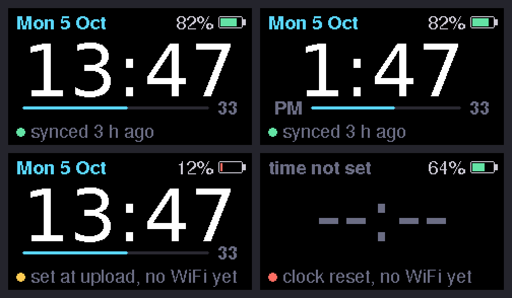

# Personal M5StickS3

A simple watch for the **M5StickS3**. It keeps the right time after you switch it off, and it can check the time online once a day so it stays accurate.



*Top left: normal 24-hour face. Top right: 12-hour mode. Bottom left: clock set from the upload, no WiFi set up yet. Bottom right: the clock chip lost power and nothing has set it yet. These are rendered from the sketch's own drawing code on a computer; a photo of the real screen will look a little different.*

## How it keeps the right time

The StickS3 has a small clock chip (an RTC, a PCF8563) that runs on the battery even when the stick is switched off. The watch reads that chip every time it starts. It writes to the chip when it learns the exact time, in one of two ways:

1. **From the internet (recommended).** Put your WiFi name and password in `wifi_secrets.h` (see below). The watch then checks an internet time server when it starts and once a day after that. It turns WiFi off as soon as it has the time. Each check sets the clock to within about a second. Between checks the chip typically drifts by a second or two a day.
2. **From the upload.** The first time the watch starts after a new upload, it sets the clock to the moment the sketch was compiled, but only if the clock looks wrong. This is close but not exact: it's a few seconds to a couple of minutes behind, and the first compile, which also builds the libraries, is the slowest. Without WiFi, nothing corrects the drift later.

The bottom line of the screen shows where the time came from. A green dot means it was checked online in the last 3 days. Amber means the time came from the upload, it hasn't been checked for a while, or the last check failed. Red means the clock lost power and the time is unknown.

If the battery ever goes completely flat, the clock chip stops. The watch notices this, shows `--:--`, and sets itself again the next time it reaches WiFi.

## Buttons

| Button | What it does |
| --- | --- |
| **Front (M5)** | Wakes the screen. Hold for 2 seconds to check the time online now. |
| **Side** | Changes brightness (3 levels, remembered). |
| **Power** | Press once to switch on. Double-press to switch off. This is built into the stick, not the sketch. |

The screen turns off after 15 seconds to save battery. Any button wakes it. While the stick is on USB power, the screen stays on, so it works as a desk clock.

## Putting it on the stick (Arduino IDE)

1. **Board package.** In *Arduino IDE → Settings → Additional boards manager URLs*, make sure this URL is listed (you probably added it for the StickC Plus2 already):
   `https://static-cdn.m5stack.com/resource/arduino/package_m5stack_index.json`
   Then open *Boards Manager*, search **M5Stack**, and install or update it.
2. **Library.** In *Library Manager*, install or update **M5Unified**. It installs **M5GFX** with it. The StickS3 needs recent versions; this was tested to compile with M5Unified 0.2.25 and M5GFX 0.2.32.
3. **Open the sketch.** Open `StickWatch/StickWatch.ino`.
4. **Set your time zone.** Near the top of the sketch, change `TIMEZONE` to the line for your city. A few common ones are listed in the sketch. **The default is London.**
5. **WiFi (optional but recommended).** In the IDE, click the `…` menu next to the file tabs and choose *New Tab*. Name it `wifi_secrets.h` and paste:
   ```cpp
   #define WIFI_SSID     "your wifi name"
   #define WIFI_PASSWORD "your wifi password"
   ```
   This file is in `.gitignore`, so your password stays on your computer. The stick only works with 2.4 GHz WiFi.
6. **Board and port.** Choose *Tools → Board → M5Stack → M5StickS3*, plug the stick in with USB-C, and pick its port.
7. **Upload.** The watch starts straight away.

If the upload can't find the stick, see M5Stack's [StickS3 upload guide](https://docs.m5stack.com/en/arduino/m5sticks3/program) for how to put it into download mode.

## Settings

All of these are at the top of `StickWatch.ino`:

| Setting | Default | Meaning |
| --- | --- | --- |
| `TIMEZONE` | London | Your time zone. It handles summer/winter time by itself. |
| `USE_24_HOUR` | `1` | `0` gives a 12-hour clock with AM/PM. |
| `SHOW_SECONDS` | `1` | `0` hides the seconds bar. |
| `SCREEN_ON_SECONDS` | `15` | How long the screen stays on after a press. `0` keeps it on all the time (uses much more battery). |
| `STAY_ON_WHEN_PLUGGED` | `1` | Keeps the screen on while the stick is on USB power. |
| `SCREEN_ROTATION` | `1` | Change it to `3` if the screen is upside down. |
| `SYNC_EVERY_HOURS` | `24` | How often to check the time online. |
| `BRIGHTNESS` | `30, 90, 200` | The three brightness levels for the side button. |

## Files

- `StickWatch/StickWatch.ino`: the watch.
- `StickWatch/wifi_secrets.example.h`: a template for your WiFi details.
- `docs/preview.png`: the screen previews above.
